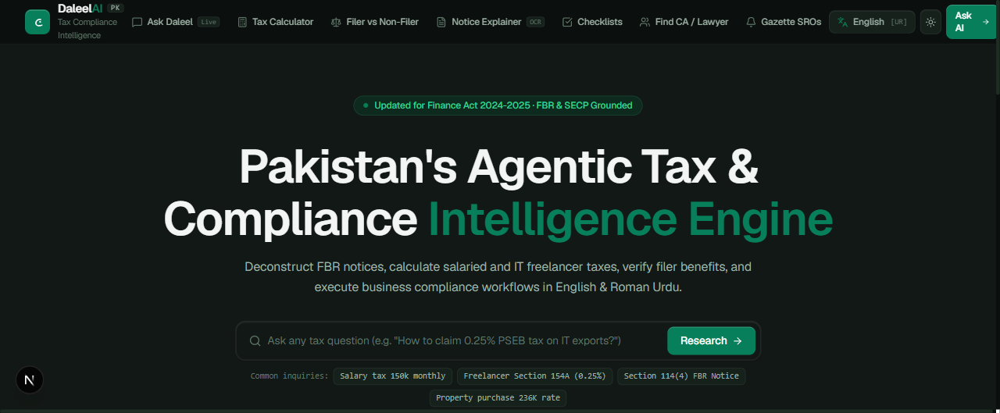
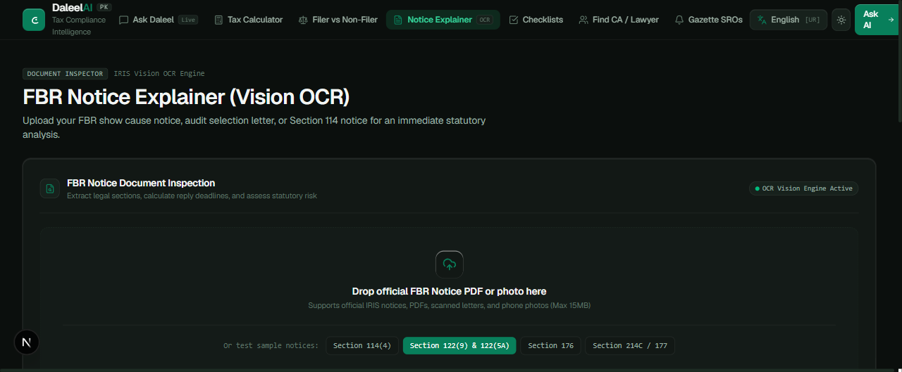
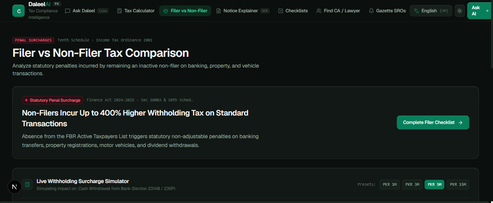
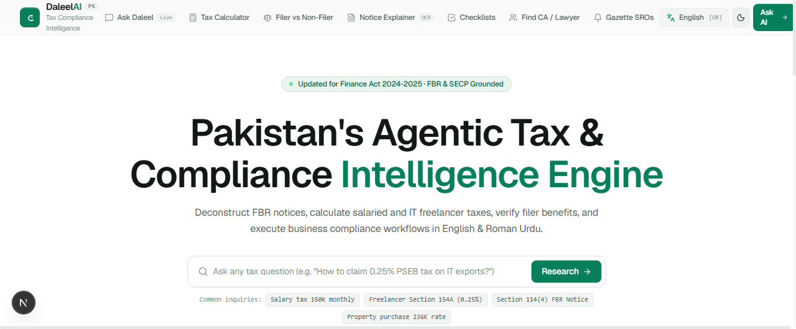
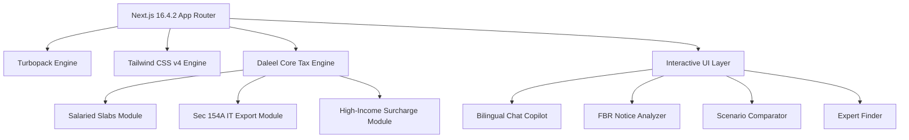

<div align="center">

# ⚖️ DaleelAI (دلیل)
### Pakistan's Premier AI-Powered Legal & Tax Intelligence Platform

[](https://nextjs.org/)
[](https://react.dev/)
[](https://www.typescriptlang.org/)
[](https://tailwindcss.com/)
[](https://turbo.build/pack)
[](https://opensource.org/licenses/MIT)
[](https://vercel.com/new/clone?repository-url=https%3A%2F%2Fgithub.com%2Fkasaam-ali%2FDaleel)

<p align="center">
  <b>Democratizing Tax Literacy & Statutory Compliance for 240M+ Citizens, Salaried Professionals, Freelancers, and Businesses across Pakistan.</b>
</p>

[Explore Features](#-core-capabilities) •
[Interactive Preview](#-visual-showcase) •
[Quickstart](#-quickstart-guide) •
[Vercel Deployment](#-1-click-deployment-to-vercel) •
[Tax Engine](#-statutory-tax-engine-architecture)

---

</div>

## 📌 Executive Summary

**DaleelAI (دلیل)** is a state-of-the-art tax navigation and compliance intelligence system engineered specifically for Pakistan's legal and economic framework. Grounded in the **Income Tax Ordinance, 2001** and amended through the **Finance Act 2024–2025**, Daleel translates intricate legal gazettes, complex tax brackets, and daunting FBR statutory notices into clear, actionable, and bilingual guidance (English & Roman Urdu).

Whether you are a software exporter navigating Section 154A withholding tax, an employee seeking take-home salary optimization, or a taxpayer responding to an FBR audit notice, Daleel provides mathematically verified computations and cited statutory references.

---

## 📸 Visual Showcase

<div align="center">

| 🏛️ Hero & Compliance Command Center | 📑 FBR Notice Explainer & OCR Defense |
|:---:|:---:|
|  |  |

| ⚖️ Comparative Tax Scenario Modeler | ☀️ Pristine High-Contrast Light Theme |
|:---:|:---:|
|  |  |

</div>

---

## ⚡ Core Capabilities

### 🧮 1. Precision Statutory Tax Engine (`/calculator`)
* **Finance Act 2024–2025 Slabs**: Dynamic progressive calculation across all 6 salaried tax brackets (from 0% up to 35%).
* **High-Income Surcharge**: Automatic detection and application of the statutory 10% surcharge for annual taxable earnings exceeding PKR 10 Million.
* **Freelancer & Tech Exporter Mode (Sec 154A)**: Computes final withholding tax rates (0.25% with PSEB registration vs. 1.0% without).
* **Real-time Tax Breakdown**: Instant visualization of monthly take-home, annual tax liability, effective tax rate, and marginal tax rate.

### 🤖 2. Daleel AI Legal & Tax Copilot (`/chat`)
* **Bilingual Intelligence**: Native conversational fluency in both English and Roman Urdu (`"Mera tax kitna banega?"`).
* **Statutory Evidence Seals**: Every legal response is attributed to specific ordinances, gazettes, circulars, and sections (Income Tax Ordinance 2001, Sales Tax Act 1990, SECP regulations).
* **Suggested Next Inquiries**: Smart contextual follow-up prompts to guide users through legal obligations.

### 📑 3. FBR Notice Explainer & Defense Drafter (`/notice`)
* **Notice Deconstruction**: Automatically decodes intimidating notices (e.g., Section 114 non-filing, Section 122 amendment of assessment, Section 176 inquiry summons).
* **Deadline & Risk Gauge**: Classifies urgency, statutory time limits (typically 10–15 calendar days), and potential legal repercussions of non-compliance.
* **Formal Reply Generator**: Generates professional, legally formatted draft replies ready for submission on the FBR IRIS portal.

### ⚖️ 4. Side-by-Side Comparative Scenario Modeler (`/compare`)
* Model alternative financial structures simultaneously: **Salaried vs. IT Exporter (Sec 154A) vs. Sole Proprietorship vs. Private Limited (SECP)**.
* Identifies optimal registration strategies and net annual tax savings.

### 👨‍💼 5. Verified Tax Expert & Consultant Directory (`/find-expert`)
* Searchable and filterable directory of accredited practitioners across Pakistan.
* Filter by designation: **FCA / ACA (ICAP)**, **FCCA / ACCA**, **ITP (Income Tax Practitioner)**, and **High Court Tax Advocates**.
* Geographically organized across Karachi, Lahore, Islamabad, Rawalpindi, and Faisalabad.

### 📋 6. Tax Return Readiness Checklist (`/checklist`)
* Interactive milestone checklist covering annual return preparation (IRIS Form 114), Wealth Statement reconciliation (Section 116), CPRs, withholding certificates, and bank statements.
* Local persistent progress tracking via `localStorage`.

### 🔔 7. Statutory Calendar & Deadline Tracker (`/notifications`)
* Comprehensive timeline of critical FBR deadlines, quarterly advance tax due dates (Section 147), sales tax returns, and Active Taxpayer List (ATL) cutoff dates.

---

## 🛠️ Technology Stack & Architecture



* **Core Framework**: [Next.js 16.4.2](https://nextjs.org/) (App Router with Partial Static Prerendering)
* **View Library**: [React 19.3.0](https://react.dev/)
* **Language**: [TypeScript 5](https://www.typescriptlang.org/) (Strict type checking enabled)
* **Styling**: [Tailwind CSS v4](https://tailwindcss.com/) with custom emerald & slate color palette
* **Iconography**: [Lucide React](https://lucide.dev/)
* **Bundler & Tooling**: Turbopack & Next.js ESLint

---

## 📁 Repository Structure

```text
Daleel/
├── public/                 # Static assets and icons
├── src/
│   ├── app/                # Next.js App Router endpoints
│   │   ├── calculator/     # Interactive Salary & Export Tax Calculator
│   │   ├── chat/           # Bilingual AI Tax Assistant Interface
│   │   ├── checklist/      # Tax Season Preparation Checklist
│   │   ├── compare/        # Side-by-Side Tax Comparison Modeler
│   │   ├── find-expert/    # Verified Tax Practitioner Directory
│   │   ├── notice/         # FBR Notice Explainer & Reply Drafter
│   │   ├── notifications/  # Tax Deadlines & Statutory Calendar
│   │   ├── layout.tsx      # Root HTML shell & metadata
│   │   └── page.tsx        # Command Center Home Dashboard
│   ├── components/         # Modular React components
│   │   ├── calculator/     # Calculation widgets and tax slab tables
│   │   ├── chat/           # Streaming chat copilot with source citations
│   │   ├── expert/         # Practitioner cards and filter controls
│   │   ├── layout/         # App navigation, header, and footer
│   │   ├── notice/         # Notice analyzer, risk meters, and reply drafter
│   │   └── shared/         # Evidence seals, badges, and logos
│   └── lib/
│       ├── tax-engine.ts   # Core statutory tax engine and slab mathematics
│       └── types.ts        # TypeScript domain models and definitions
├── .env.example            # Environment variable documentation
├── next.config.ts          # Turbopack and build configuration
├── package.json            # Project dependencies and deployment scripts
└── tsconfig.json           # TypeScript configuration
```

---

## 🚀 Quickstart Guide

### Prerequisites
* **Node.js**: `v20.x` or higher installed
* **npm**, **pnpm**, or **yarn**

### 1. Clone the Repository
```bash
git clone https://github.com/kasaam-ali/Daleel.git
cd Daleel
```

### 2. Install Dependencies
```bash
npm install
```

### 3. Setup Environment Variables
Create a local `.env.local` file by copying the template:
```bash
cp .env.example .env.local
```
*(Note: Daleel is pre-configured with a rich standalone statutory engine. Adding a `GEMINI_API_KEY` is optional for custom live Gemini OCR and external LLM streaming).*

### 4. Run the Development Server
```bash
npm run dev
```
Open [http://localhost:3000](http://localhost:3000) in your browser to experience DaleelAI.

### 5. Build for Production
```bash
npm run build
npm run start
```

---

## 🌐 1-Click Deployment to Vercel

DaleelAI is optimized for zero-configuration, lightning-fast deployment on [Vercel](https://vercel.com):

1. **Push to your GitHub repository**:
   ```bash
   git push -u origin main
   ```
2. **Import into Vercel**:
   * Navigate to [vercel.com/new](https://vercel.com/new).
   * Select the repository `kasaam-ali/Daleel`.
   * Keep build command as default (`next build`).
3. **Environment Variables (Optional)**:
   * `NEXT_PUBLIC_APP_URL` = `https://your-domain.vercel.app`
   * `GEMINI_API_KEY` = `(Your key if using external Google Gemini services)`
4. Click **Deploy**. Your application will be live across worldwide edge networks in seconds!

---

## ⚖️ Statutory Legal & Regulatory Disclaimer (قانو نی انتباہ)

> [!CAUTION]
> ### 🛑 Critical Compliance & Legal Advisory Notice
>
> 1. **No Official Affiliation**: **DaleelAI (دلیل) is an independent civic-technology and educational research project**. It is **NOT** owned, managed, affiliated with, or endorsed by the **Federal Board of Revenue (FBR)**, the **Securities and Exchange Commission of Pakistan (SECP)**, or any Federal / Provincial Government Ministry.
> 2. **Informational & Assistive Purpose Only**: All calculations, tax bracket estimates, simulated OCR notice deconstructions, and AI chat responses are provided solely for general educational, personal budgeting, and preliminary awareness purposes based on the *Income Tax Ordinance, 2001* and *Finance Act 2024–2025*.
> 3. **No Professional / Attorney-Client Privilege**: Using DaleelAI does **NOT** constitute or create an attorney-client, advocate-client, auditor-client, or fiduciary relationship under Pakistani law.
> 4. **Mandatory Professional Consultation**: Pakistani tax legislation and statutory rules (S.R.O.s) are subject to judicial interpretations, circulars, and departmental updates. For official tax return filing on IRIS, responding to Show Cause Notices under Section 122/176, or contesting assessment orders before the Commissioner (Appeals) or the Appellate Tribunal Inland Revenue (ATIR), **taxpayers MUST seek formal counsel from a certified Chartered Accountant (FCA/ACA - ICAP) or licensed High Court Tax Advocate**.
> 5. **Limitation of Liability**: The authors, contributors, and platform operators shall not be held liable for any fiscal penalties, default surcharges under Section 205, adverse assessment orders, or financial damages arising from reliance upon outputs generated by this platform.

---

## 👨‍💻 Author & Contributions

* **Author**: [Kasaam Ali](https://github.com/kasaam-ali)
* **Repository**: [https://github.com/kasaam-ali/Daleel.git](https://github.com/kasaam-ali/Daleel.git)
* **Contributions**: Pull requests, feature proposals, and tax rule amendments are welcome. Please open an issue first to discuss what you would like to change.

<div align="center">

**Made with 💚 for the taxpayers and digital economy of Pakistan.**

</div>
